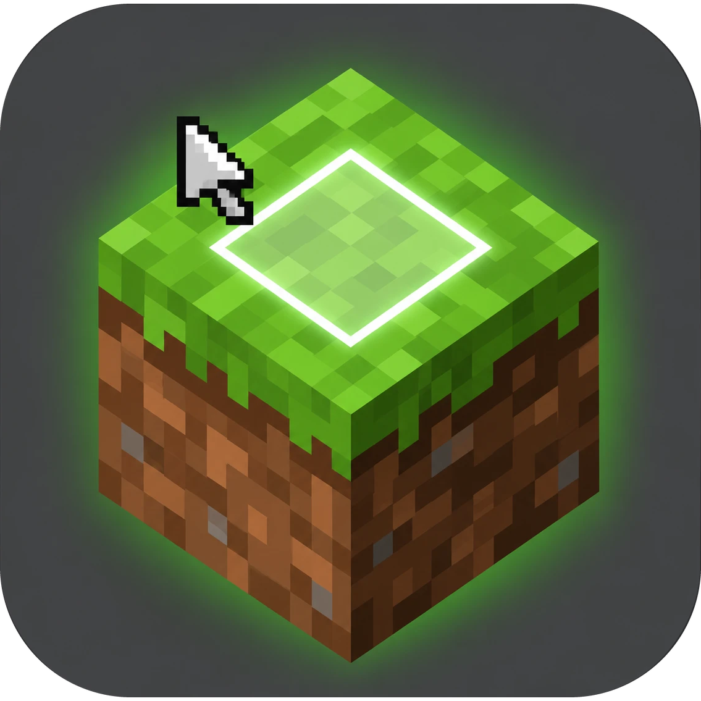
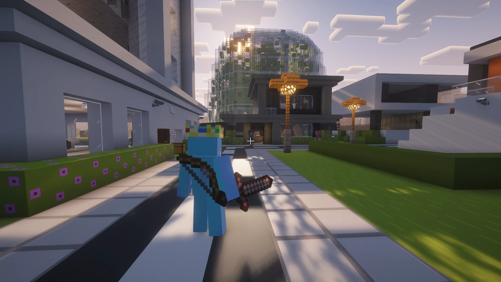
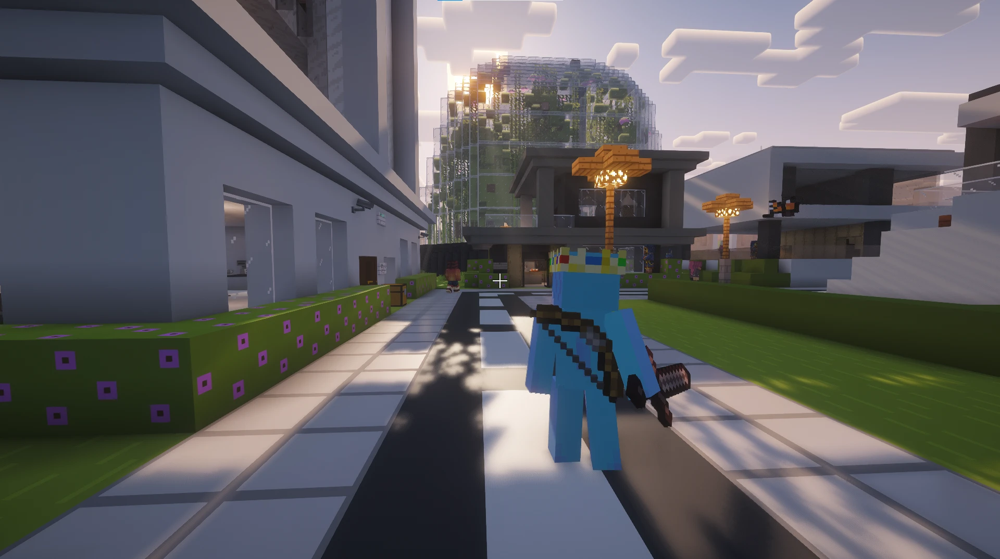
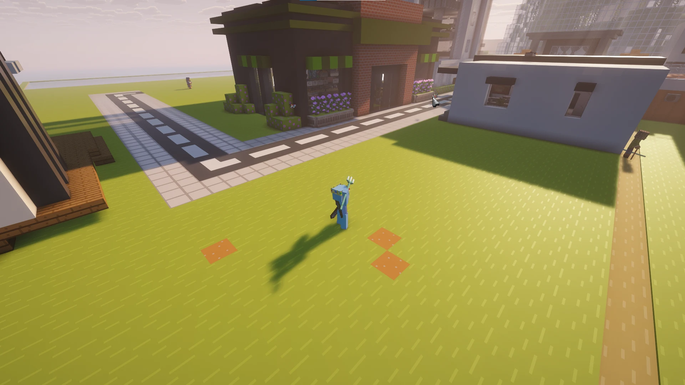
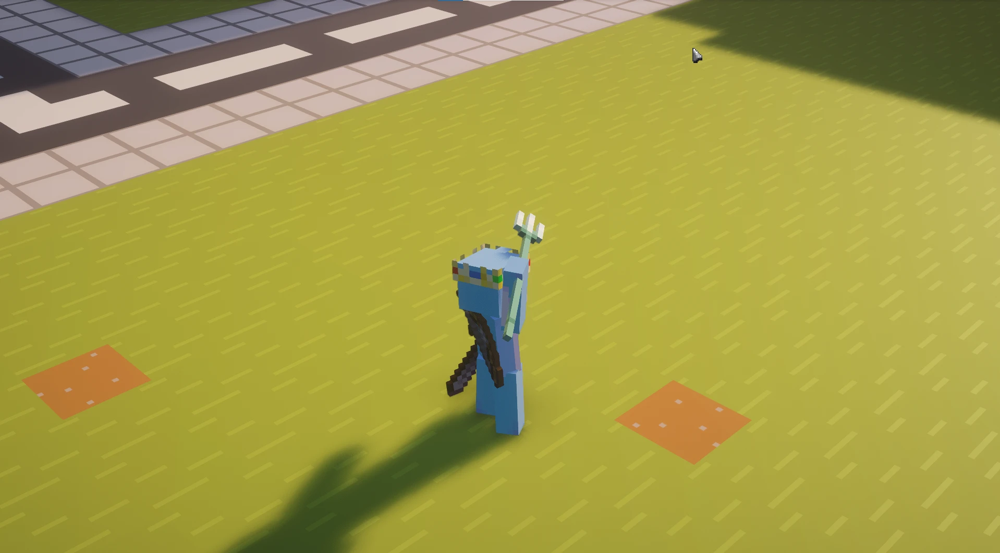
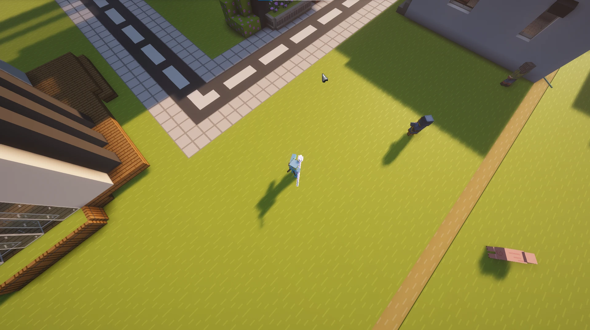

<!-- The mod icon (vantage-icon.png, transparent rounded corners). -->

# Vantage

**See your world from a new vantage point.**

Over-the-shoulder and *Minecraft Dungeons*-style cameras for Minecraft Bedrock.

`v0.2.1` · `Minecraft Bedrock 1.26.60` · `LeviLamina 26.60.x` · `Windows x64` · client only

[**⬇ Download the latest release**](../../releases/latest)

---

Vantage is a client-side [LeviLamina](https://github.com/LiteLDev/LeviLamina) mod. It adds two new
ways to see your world: a **shoulder camera** for building and fighting in third person, and a
**Dungeons camera** that looks down on your character from above. The server needs nothing
installed, so it works in single player, worlds you host, Realms and servers.

> [!NOTE]
> Vantage is in active development and is tested by hand on a single game version. Expect the odd
> rough edge, and please report what you find.

## Contents

- [Showcase](#-showcase)
- [Features](#-features)
- [Make it yours](#-make-it-yours)
- [Controls](#-controls)
- [Installing](#-installing)
- [Settings](#-settings)
- [How it works](#-how-it-works)
- [Future features](#-future-features)
- [Credits](#-credits)

## 📸 Showcase

<table>
<tr>
<td width="50%"></td>
<td width="50%"></td>
</tr>
<tr>
<td align="center"><b>Shoulder camera, right</b> Fixed crosshair beside you; blocks and hits land on it</td>
<td align="center"><b>Shoulder camera, left</b> Swap sides any time with F5</td>
</tr>
</table>

<b>Dungeons camera</b> Point with the cursor, move with WASD relative to the screen

<table>
<tr>
<td width="50%"></td>
<td width="50%"></td>
</tr>
<tr>
<td align="center"><b>Zoomed in</b> Scroll to zoom</td>
<td align="center"><b>Steep top-down</b> Arrow keys tilt, Q / E rotate</td>
</tr>
</table>

## ✨ Features

### 🎯 Shoulder camera
- Third-person views over your **right** or **left** shoulder, added to the **F5** cycle.
- Adjustable **distance**, **side offset** and **height**.
- A fixed **crosshair** beside your character. Placing, mining and attacking land on whatever is under
  it, not where vanilla third person would aim.

### 🗺️ Dungeons camera
- A fixed camera high above you, like *Minecraft Dungeons*, with adjustable **distance**, **angle** and
  **rotation**.
- The mouse moves an **on-screen cursor**. Your character turns to face the spot under it, and clicks
  place, mine and attack exactly there.
- **WASD moves relative to the screen**: W always goes up the screen, whichever way you face.
- A glowing **3D marker** shows the targeted block face. Roofs and ceilings never catch the cursor, so
  it always lands at your level, even underground.
- **Rotate** with Q / E, **tilt** with the arrow keys and **zoom** with the scroll wheel, all with
  smooth glides. In this mode those keys never drop items, open the inventory or scroll the hotbar.

### 🧱 See-through blocks
- In third person and Dungeons, blocks between you and the camera are **cut away** instead of the
  camera pushing in. You can see yourself under roofs and in tunnels.

### ⚙️ Settings screen
- **F6** opens a full **Camera Settings** screen with a sidebar, switches, sliders and dropdowns.
- Changes apply as soon as you press Submit.

## 🎛️ Make it yours

Every angle is yours to tune: live in game with the keys, or precisely in the **F6** settings
screen. Changes glide into place and are saved for next time.

### 🎯 Shoulder camera

| Setting | Range | What it changes |
|---|---|---|
| **Distance** | 1 – 8 blocks | How far behind you the camera sits |
| **Side offset** | 0 – 1.5 | How far over your shoulder it leans |
| **Height offset** | −0.5 – 1 | Lower for a low-angle look, higher for an over-the-head view |
| **Starting side** | Right / Left | Which shoulder F5 reaches first |

### 🗺️ Dungeons camera

| Setting | Range | In game | What it changes |
|---|---|---|---|
| **Distance** | 6 – 30 blocks | | How high above you the camera starts |
| **Zoom** | 30° – 110° field of view | **Scroll** | Push in close or pull out wide |
| **Angle** | 30° – 85° | **↑ / ↓** | From a low, cinematic tilt to straight down |
| **Rotation** | 8 directions, 45° steps | **Q / E** | Which way "up the screen" faces |
| **Cursor sensitivity** | 0.1 – 2.0 | | How fast the on-screen cursor moves |
| **Screen-relative movement** | On / Off | | WASD follows the screen, or your facing |
| **3D aim cursor** | On / Off | | The glowing marker on the targeted block |

### 🌐 Everything else

| Setting | Options | What it changes |
|---|---|---|
| **F5 cycle** | Pick any views | Which views F5 steps through |
| **Third person crosshair** | On / Off | The fixed crosshair in the behind and shoulder views |
| **See-through blocks** | On / Off | Cut away blocks between you and the camera |
| **Transition speed** | Instant · Fast · Normal · Slow | How quickly views glide into each other |

Mix them: a tight right-shoulder cam for building, a wide 30° Dungeons view for exploring, a steep
85° one for caves and bases.

## 🎮 Controls

| Key | Where | Action |
|---|---|---|
| **F5** | Anywhere | Cycle views: first person → behind → shoulder right → shoulder left → Dungeons → front |
| **F7** | Anywhere | Switch the Dungeons camera on or off |
| **F6** | Anywhere | Open or close Camera Settings |
| **Mouse** | Dungeons | Move the cursor (your character faces it) |
| **Q / E** | Dungeons | Turn the camera 45° left / right |
| **↑ / ↓** | Dungeons | Tilt the camera flatter / steeper |
| **Scroll** | Dungeons | Zoom in / out |

Each extra view (shoulders, Dungeons, front) can be removed from the F5 cycle in the settings.

## 📦 Installing

**You need:** Minecraft Bedrock **1.26.60** on Windows with
**[LeviLamina](https://github.com/LiteLDev/LeviLamina) 26.60.x** installed.

1. Go to the [**latest release**](../../releases/latest).
2. Under **Assets**, download `vantage.zip`.
3. Unzip it. You get a folder called `vantage`.
4. Copy that folder into your game's `mods/` folder (the one LeviLamina created).
5. Start the game, load a world and press **F6**. If the Camera Settings screen opens, Vantage is
   installed.

**Updating:** download the newer release and replace the `vantage` folder in `mods/`. To keep your
settings, keep the `config` folder from the old copy.

**Coming from Better Cameras?** Vantage is the same mod under a new name. Delete the old
`better_cameras` folder from `mods/`. To keep your settings, copy `better_cameras/config/config.json`
into `vantage/config/`.

**Uninstalling:** delete the `vantage` folder from `mods/`.

## ⚙️ Settings

| Section | Settings |
|---|---|
| **F5 Cycle** | Which views F5 steps through |
| **Shoulder Camera** | Distance · Side offset · Height offset · Starting side |
| **Dungeons Camera** | Distance · Angle · Rotation · Screen-relative movement · 3D aim cursor · Cursor sensitivity |
| **General** | Third person crosshair · See-through blocks · Transition speed · Reset to defaults |

Settings are saved in `mods/vantage/config/config.json`.

## 🧠 How it works

The cameras are Bedrock's own. Vantage applies them from your game instead of a server, then adds
aiming, movement and rendering on top.

### Cameras
- Bedrock ships camera presets that servers switch on with `/camera`: `minecraft:follow_orbit` is the
  shoulder camera and `minecraft:fixed_boom` is the Dungeons camera.
- Vantage builds the same `CameraInstructionPacket` a server would send and hands it to the game's own
  packet handler, so nothing goes over the network.
- Preset changes (distance, shoulder offset, how far the view may turn) are written into the client's
  copy of the presets and handed back to the game as a local `CameraPresetsPacket`.
- F5 is a hook on `ClientInputCallbacks::handleTogglePerspectiveButtonPress`.
- Q / E and the arrow keys glide the running camera to its new angle. A moment later Vantage quietly
  re-applies the camera at that angle with no transition, so the range your view can turn in follows
  the new direction.
- The scroll wheel changes the camera's field of view with a short ease, a smooth zoom.

### Screen ↔ world
- Every frame Vantage reads the view and projection matrices the world was drawn with.
- From those, the cursor or crosshair becomes an exact ray into the world, and world points become
  exact screen positions, at any zoom and from the camera's true position.

### Aiming
- That ray finds the block, face or mob under the cursor or crosshair. In the Dungeons camera, blocks
  above your head height are skipped, so roofs never catch it.
- Vantage swaps the result into the game's `GameMode` calls (start / continue / finish breaking,
  place, use item on, attack, interact) and into the game's hit result. Placing, mining and fighting
  happen there, under the normal rules and your normal reach.
- Only your own player on your own client is affected. In a world you host, friends' actions pass
  through unchanged.

### Dungeons controls
- Mouse movement drives the on-screen cursor. What the game receives instead is the small turn needed
  to face the cursor's spot, so the game turns your character itself and its own look state never
  fights Vantage.
- WASD is rotated from the camera's frame into your character's before the game uses it. Bedrock's
  control scheme is left alone, so the server computes the same movement: no rubber banding.
- Q / E, the arrow keys and the wheel are kept from the game while the mode is on: no item drops,
  inventory or hotbar scrolling.

### See-through blocks
- Blocks along the line from your head to the camera's true position are left out of the chunk mesh
  (a `BlockTessellator` hook), and those chunks are re-meshed whenever that set changes.
- The camera's own collision check is switched off at the same time, so it keeps its distance
  instead of pushing in.

### Settings screen
- Vantage draws its own screen over the game every frame (`AfterUIRenderEvent`).
- An empty vanilla form underneath frees the mouse cursor, keeps input from your character and closes
  with Esc. Clicks and drags are read from Windows directly.
- Mojang's own options screen is OreUI, built from JavaScript inside the game, so it can't take a new
  entry.

## 🗺️ Future features

Ideas being considered, roughly in order:

- **Controller support**
  - Dungeons aiming with the right stick, console-Dungeons style: your character faces where you push
    it and the marker sits ahead in that direction.
  - D-pad to rotate and tilt the Dungeons camera, plus a zoom button.
  - Navigating the settings screen with the stick / D-pad, A to toggle, B to close.
- **Crosshair position sliders** to place the shoulder crosshair exactly where you like it.
- **Per-view field of view** for the shoulder and Dungeons cameras.
- **Rebindable keys** for F6 / F7 / Q / E from the settings screen.
- **Smoother see-through**: fading blocks in and out instead of cutting them away instantly.

Suggestions are welcome; open an issue.

## 🙏 Credits

- **[LeviMC / LiteLDev](https://github.com/LiteLDev)**: [LeviLamina](https://github.com/LiteLDev/LeviLamina),
  the mod loader and the Bedrock headers Vantage is built on.
- Camera ideas inspired by *Minecraft Dungeons* and third-person shoulder-camera mods.

---

**Vantage** is a fan-made mod and is not affiliated with Mojang Studios or Microsoft.
*Minecraft* and *Minecraft Dungeons* are trademarks of Mojang Studios.

